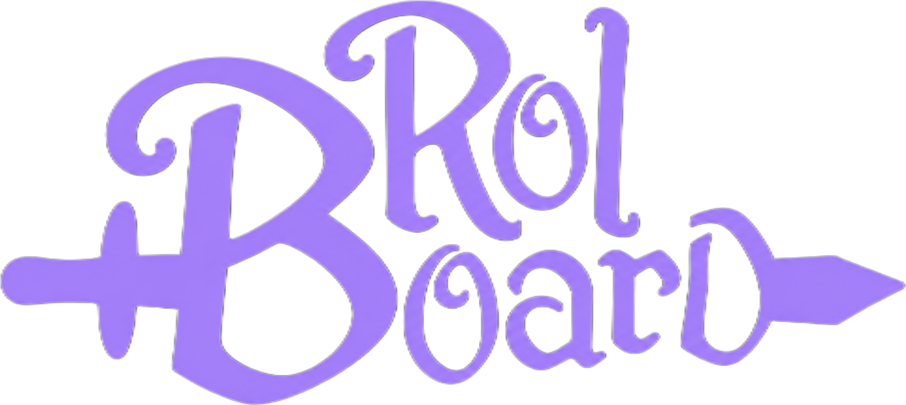

<div align="center">




**Website for Rolboard**

[](https://react.dev)
[](https://www.typescriptlang.org)
[](https://vite.dev)
[](https://workers.cloudflare.com)
[](#license)

[Español](README.es.md)

</div>

---

Site that presents [Rolboard](https://github.com/ncorrea-13/rolboard) and links to its downloads. Built with React and TypeScript on Vite, prerendered to plain static HTML at build time and hydrated in the browser, so it works as a static site on Cloudflare.

| Page        | Route       | What it has                                                                                                        |
| ----------- | ----------- | ------------------------------------------------------------------------------------------------------------------ |
| Home        | `/`         | Hero with a playable initiative tracker and d20, the features in tabs, Android, the Obsidian teaser, house rules   |
| Obsidian    | `/obsidian` | How a vault becomes sheets: steps, an interactive folder guide with the real frontmatter keys, an example note     |
| AI          | `/agents`   | Connecting Claude, OpenCode, Codex and Antigravity through MCP: desktop and Docker paths, supported clients, limits |
| FAQ         | `/faq`      | General questions, a sync guide that works with any tool (or none) and the bug-report links                        |
| Download    | `/download` | Installers with the visitor's platform first, the current version and the install-related questions                |

Also: a `Ctrl` + `K` palette to jump between sections and pages, and a floating menu button on phones and tablets.

## Stack

| Layer   | Tech                                                                     |
| ------- | ------------------------------------------------------------------------ |
| Page    | React 19 + TypeScript + Vite, prerendered with `scripts/prerender.mjs`   |
| Styles  | Plain CSS on the app's tokens, SVG ornaments, no UI framework            |
| Fonts   | Fraunces, Inter and IBM Plex Mono, self-hosted with Fontsource           |
| Tooling | pnpm, oxlint, prettier, vitest                                           |
| Hosting | Cloudflare Workers (static assets)                                       |

Colors and fonts mirror the app's tokens (`client/src/styles/tokens.css`).

## Development

```bash
pnpm install
pnpm dev          # Vite dev server (serves /faq, /download... like production)
pnpm build        # typecheck + client build + prerender into dist/
pnpm preview      # serve dist/
pnpm test         # vitest (demo logic, page registry, dictionaries)
pnpm lint         # oxlint
pnpm typecheck    # tsc --noEmit
pnpm format       # prettier
```

Layout: `src/site.ts` (the page registry: nav, menu, palette, footer and sitemap read it), `src/pages`, `src/sections`, `src/components`, `src/demos` (the playable initiative tracker and d20), `src/i18n` (dictionaries) and `src/styles` (tokens first, then base, ornaments, `aura.css`, layout, pages and `motion.css`). The images live in `public/assets`.

### Adding a page

1. Add an entry to `PAGES` in `src/site.ts` and its metadata keys to both dictionaries.
2. Create the component in `src/pages` and register it in `src/App.tsx`.

The prerender writes its file and the sitemap entry; the nav, mobile menu, palette and footer pick it up.

### Routes and links

One HTML template (`index.html`) serves every page; the prerender fills its title, description and `og:url` per page. Links use clean URLs (`/faq`, not `/faq.html`): Cloudflare serves `faq.html` at `/faq`. The link check in CI resolves them with `lychee --fallback-extensions html`.

### Motion and visuals

Animations are one-shot or driven by input (scroll, pointer, click), nothing loops, and `prefers-reduced-motion` switches them off. The violet sky with constellations and the magic circles are a reusable utility: `aura` classes in `aura.css` plus the `Sigil` component (three designs).

## Checks

CI runs `oxlint`, `tsc`, the tests and the build, validates the built pages with `html-validate` and checks every link with `lychee`.

## Deploy

Deployed by Cloudflare Workers Builds, connected to this repo. Build command: `pnpm install --frozen-lockfile && pnpm build`; deploy command: `npx wrangler deploy`, which serves `dist/` as static assets (`wrangler.jsonc`). The Node version comes from `.node-version`. The custom domain is set on the Worker, under *Settings → Domains & Routes*.

## Downloads

The download buttons read the asset URLs of the latest Rolboard release from the GitHub API, matching `windows-amd64*.exe`, `linux-amd64*.AppImage` (or `linux-x86_64*.AppImage`, the name used up to v0.2.1) and `android-arm64*.apk` (release assets are named like `rolboard-windows-amd64-v0.1.1.exe`). If the API can't be reached, they link to the latest release page. The same request shows the current version on the home page and on the download page.

The page detects the visitor's OS and highlights the matching download.

## Language

Spanish and English. The page picks the browser language (`es*` → Spanish, anything else → English) unless the visitor chose one with the toggle, which is remembered in `localStorage`. Both languages live in `src/i18n`: `es.ts` is the source and `en.ts` must define the same keys, which `tsc` checks. The static HTML is Spanish; the saved or browser language is applied after hydration.

## Screenshots

`public/assets/screens/` comes from a fictional demo campaign, captured at 1440×900, 2x scale.

## License

MIT - see the [Rolboard license](https://github.com/ncorrea-13/rolboard/blob/main/LICENSE).

Logos and icons (`public/assets/logo-*.png`, `public/assets/favicon.png`) are © Mateo Guareschi, used with permission. They are **not** covered by the MIT license.

---

_Mendoza, Argentina · Nicolás Correa ([ncorrea-13](https://github.com/ncorrea-13))_
